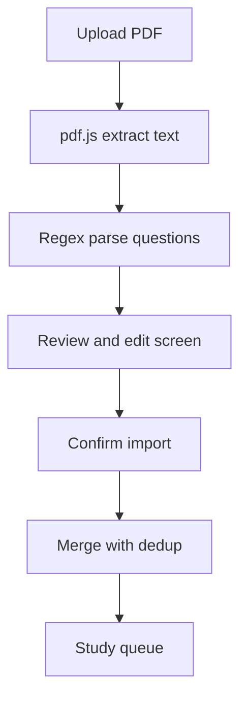

# PDF → CSV Question Import — Refined Plan

## Idea (refined through grilling)
Add the ability to import MCQ questions directly from a **text-based PDF** into the study app. The app extracts questions, options, and the correct answer (marked with `*`), lets the user review/edit them, then imports them using the existing merge + dedup logic.

## Confirmed decisions
| # | Decision | Choice |
|---|----------|--------|
| 1 | Conversion location | Client-side in browser (pdf.js) |
| 2 | PDF type | Text-based (selectable text) |
| 3 | Correct answer | Marked with `*` after the option |
| 4 | Language | Chinese (and English-capable) |
| 5 | Parsing method | Regex / heuristics |
| 6 | Workflow | Review/edit before import |
| 7 | Explanations | None (PDF has none) |
| 8 | Topic tag | Auto-tag with PDF title |
| 9 | Review capabilities | Full editing: question, options, correct answer, topic, delete |
| 10 | Unmarked answers | Flag in review for manual selection |
| 11 | UI location | New "PDF" option on the existing Import screen |
| 12 | Import behavior | Reuse existing merge + dedup |

## Sample PDF format (from user)
```
第十七屆澳門青少年外交知識競賽預習題
（共 300 題）
1/37
1、中國古代官方使者的身份象徵是 。
A. 虎符
B. 節*
C. 國書
2、明朝初年，鄭和奉命出使 次下西洋的航海活動...
A. 5
B. 6
C .7*
```

## Parsing rules (regex/heuristics)
- **Question start:** line matching `^\d+[、.．]\s*(.+)$` → begins a new question; capture the question text.
- **Options:** lines matching `^[A-D][.．、]\s*(.+)$` → option text. The `*` at the end marks the correct answer (strip it and record the index).
- **Multi-line questions:** continuation lines that don't match a question-start or option pattern are appended to the current question text.
- **Filter out:** page markers (`1/37`), headers (`（共 300 題）`), the document title, and blank lines.
- **Correct answer:** the option whose text ends with `*`. If none found, flag the question for manual review.
- **Topic:** default to the PDF's first non-empty title line (e.g. `第十七屆澳門青少年外交知識競賽預習題`).
- **Options count:** 2–4 supported (matches existing parser).

## New files / changes
- `src/lib/pdfParser.ts` — pdf.js text extraction + regex question parser → `Question[]` with `flagged` metadata
- `src/components/PdfImport.tsx` — PDF upload, parse progress, review/edit table, confirm import
- `src/components/ImportView.tsx` — add a "PDF" tab/option alongside CSV/JSON
- `src/App.tsx` — wire PDF import into the existing `setQuestions` merge + dedup
- `package.json` — add `pdfjs-dist` dependency

## Review/edit screen
- Table/list of parsed questions
- Editable: question text, each option, correct answer (radio), topic
- Delete button per question
- Unmarked-answer questions highlighted with a warning badge
- "Import N question(s)" button → calls existing merge + dedup

## Flow


## Edge cases handled
- Page numbers and headers filtered
- Multi-line questions merged
- `*` marker with/without spaces (`節*` vs `C .7*`)
- Questions with no detected answer flagged for review
- Re-importing the same PDF does not duplicate (dedup by question-text id)
