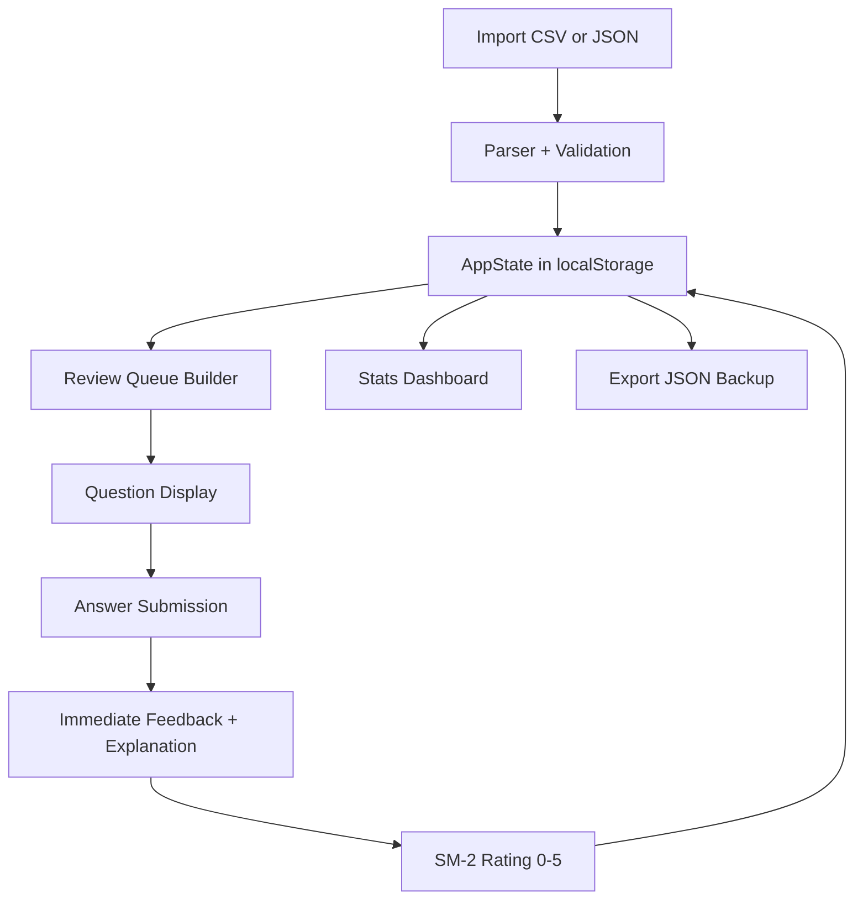

# Custom MCQ Study App — Build Plan

## Overview
A React + Vite web app that imports MCQ questions from CSV/JSON, presents them one at a time (grouped by topic when there are many), gives immediate feedback with optional explanations, and applies the **SM-2 spaced repetition algorithm** to optimize retention. Progress is stored in the browser (localStorage) with JSON export/import for backup and device migration.

## Tech Stack
- **React 18 + Vite** (TypeScript) — fast, component-based UI
- **localStorage** — persistence for review state (small data set; IndexedDB only if needed later)
- **PapaParse** — robust CSV parsing
- **CSS** — clean, focused study interface (no heavy UI framework needed)

## Data Models (TypeScript)

### Question
```ts
interface Question {
  id: string;            // stable id (hash of content or uuid)
  question: string;      // the prompt
  options: string[];     // exactly 4 options
  correctIndex: number;  // index of correct option (0-3)
  explanation?: string;  // optional
  topic?: string;        // optional subject/topic tag
}
```

### ReviewState (per question, SM-2)
```ts
interface ReviewState {
  questionId: string;
  repetitions: number;   // number of successful reviews in a row
  interval: number;      // current interval in days
  easeFactor: number;    // SM-2 ease factor (starts 2.5)
  dueDate: string;       // ISO date when next review is due
  lastReviewed?: string; // ISO timestamp
  lapses: number;        // times answered incorrectly
}
```

### AppState (persisted)
```ts
interface AppState {
  questions: Question[];
  reviews: Record<string, ReviewState>; // keyed by questionId
  settings: { newPerDay: number; maxReviewsPerDay: number };
}
```

## SM-2 Algorithm
Standard SM-2 with quality ratings 0–5:
- **Quality 0–3** (wrong / hard): reset repetitions to 0, interval to 1 day, ease factor decreases.
- **Quality 4–5** (good / easy): increase interval using `interval = round(interval * easeFactor)`.
- Ease factor update: `EF' = EF + (0.1 - (5 - q) * (0.08 + (5 - q) * 0.02))`, clamped to min 1.3.
- New questions start with interval 1 day, ease factor 2.5.

## Architecture / Component Flow



## Components
- **App** — top-level state provider, routing between views
- **ImportView** — file upload (CSV/JSON), validation errors, preview
- **StudyView** — one question at a time; topic section headers when grouped
- **QuestionCard** — renders prompt + 4 options, handles selection
- **FeedbackPanel** — correct/incorrect, shows explanation, SM-2 rating buttons
- **ReviewQueue** — picks due questions + new questions (respecting daily limits)
- **StatsView** — due today, mastered, per-topic breakdown, streak
- **SettingsView** — daily limits, export/import JSON, clear data

## Key Behaviors
1. **Import:** Accept `.csv` or `.json`. CSV columns: `question, optionA, optionB, optionC, optionD, correct, explanation, topic`. Validate exactly 4 options and a valid correct answer; report row-level errors.
2. **Study flow:** Show one question → user picks an option → immediate feedback (correct/incorrect + explanation) → user rates retention quality (0–5) → SM-2 updates review state → next question.
3. **Sections:** If a session has many questions, group by topic with section headers; otherwise show one at a time.
4. **Review queue:** Prioritize due questions, then new questions up to `newPerDay`. Respect `maxReviewsPerDay`.
5. **Persistence:** Save `AppState` to localStorage on every change. Export/import full JSON for backup.

## Project Structure
```
study-app/
├── index.html
├── package.json
├── vite.config.ts
├── tsconfig.json
├── src/
│   ├── main.tsx
│   ├── App.tsx
│   ├── types.ts
│   ├── lib/
│   │   ├── sm2.ts          # SM-2 algorithm
│   │   ├── parser.ts       # CSV/JSON import + validation
│   │   ├── storage.ts      # localStorage load/save/export/import
│   │   └── queue.ts        # review queue builder
│   ├── components/
│   │   ├── ImportView.tsx
│   │   ├── StudyView.tsx
│   │   ├── QuestionCard.tsx
│   │   ├── FeedbackPanel.tsx
│   │   ├── StatsView.tsx
│   │   └── SettingsView.tsx
│   └── styles.css
└── sample-questions.csv
```

## Testing
- Import sample CSV and JSON, verify validation errors surface correctly.
- Answer questions correctly/incorrectly, verify SM-2 intervals and due dates change.
- Reload page, verify progress persists.
- Export JSON, clear data, re-import, verify state restored.
